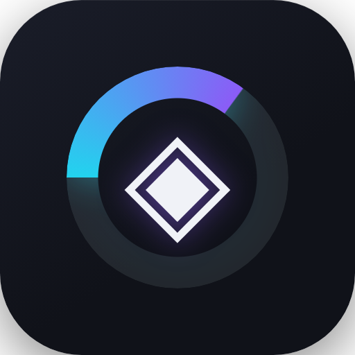
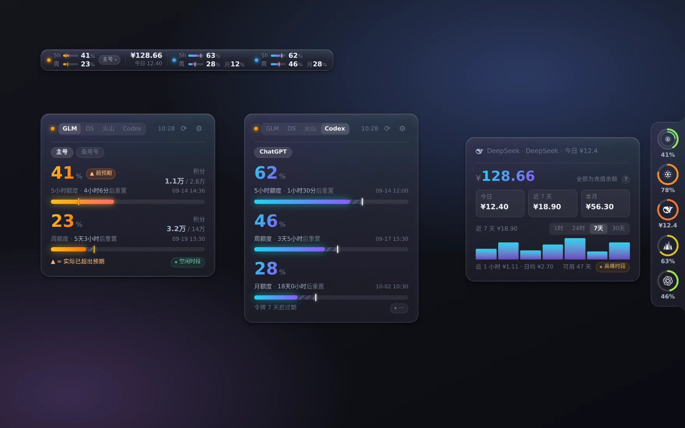

<div align="center">
  
  <h1>QuotaDock</h1>
  <p><strong>A sleek, always-on-top desktop widget for AI quotas & API balances</strong></p>
  <p>Monitor real-time usage across GLM Coding Plan, DeepSeek, Volcengine Ark, OpenAI Codex, and Google Gemini (Antigravity) right from your desktop corner.</p>

  <p>
    <a href="https://github.com/liuxsh9/quotadock/actions/workflows/release.yml"></a>
    <a href="https://github.com/liuxsh9/quotadock/releases/latest"></a>
    <a href="https://github.com/liuxsh9/quotadock/releases"></a>
    
    <a href="LICENSE"></a>
  </p>

  <p><a href="README.md">简体中文</a> · <strong>English</strong></p>
</div>

<p align="center">
  
  <br>
  <sub>Floating Capsule (multi-provider, multi-account) · Detail Panel (pace forecast & spend chart) · Fluid Edge Dock with hover flyout cards</sub>
</p>

## Features

- **Dual Desktop Modes**: Lives as a compact floating capsule; drag to the left or right screen edge to snap into a fluid edge-docked column of progress rings (with dual-ring 5h + weekly support) and instant hover flyout cards.
- **Expected Pace & Overspend Alerts**: Every quota bar overlays a time-proportional pace guide—when actual usage outpaces the window, the overshoot segment highlights in red and shifts the gauge to amber before you hit the cap.
- **Multi-Provider, Multi-Account**: Attach multiple accounts per provider with either *Switch* (dropdown/wheel cycle) or *Tile* (side-by-side) capsule layouts, independent severity colors, and per-account dock metrics.
- **Zero-Copy Remote SSH Support**: For **OpenAI Codex** and **Google Gemini (Antigravity)** authenticated on remote Linux/macOS dev servers, QuotaDock queries live status over built-in Windows OpenSSH—no manual token copying or expiry churn.
- **Polished Desktop Ergonomics**: Auto dark/light glassmorphism matching your desktop background luminance, privacy-masked balances by default, multi-monitor DPI/hot-plug awareness, jittered polling with backoff, and system tray integration.
- **Privacy-First & Direct**: All credentials stay strictly local, never leave the Electron main process, and connect directly to official vendor endpoints with zero telemetry.

## Supported Providers

| Provider | Tracked Metrics | Authentication / Source | Highlights |
|---|---|---|---|
| **GLM Coding Plan** | 5h / weekly quota %, points, reset countdown | API Key (recommended) or login Cookie | Peak/off-peak indicator, 5h + weekly dual ring |
| **DeepSeek API** | Account balance, today / 7d / monthly spend, est. days left | API Key (+ optional `userToken` for exact billing) | 2-min balance polling, 1h/24h/7d/30d charts, off-peak half-price indicator |
| **Volcengine Ark (Coding / Agent)** | 5h / weekly / monthly call-count windows | Read-only IAM sub-account AK / SK | Auto plan detection; supports monitoring both plans via separate accounts |
| **OpenAI Codex** | 5h / weekly / monthly windows + per-model extra limits | **SSH remote** / local `~/.codex/auth.json` / paste | Read-only `access_token`—never touches `refresh_token` or logs out CLI |
| **Google Gemini (Antigravity)** | 5h / weekly quota (Gemini & Claude/GPT model groups) | Official `agy` CLI (local / **SSH remote**) | Zero token/quota consumption, passwordless & never expires |

## Installation

Supports **Windows 10 / 11 (x64)**. Grab a build from [Releases](https://github.com/liuxsh9/quotadock/releases/latest):

| Package | Notes |
|---|---|
| `QuotaDock-x.y.z-win64.zip` | **Recommended · Directory Build**: Unzip and run `QuotaDock/QuotaDock.exe` (~1s cold start, supports launch-at-login) |
| `QuotaDock Setup x.y.z.exe` | **Installer**: Guided setup with desktop shortcut and launch-at-login |
| `QuotaDock x.y.z.exe` | **Portable EXE**: Single-file self-extracting binary (slower cold start; no launch-at-login) |

> Upgrading from the legacy **GLM 用量挂件** (`glm-quota-widget`)? On first launch, QuotaDock automatically copies your existing `config.json` and history from `%APPDATA%\GLM 用量挂件\` non-destructively.

<details>
<summary>Windows SmartScreen ("Windows protected your PC")?</summary>

As an unsigned open-source build, Windows marks downloaded archives with Mark-of-the-Web. Right-click the `.zip` → **Properties** → check **Unblock** before extracting, or click **More info → Run anyway**.

</details>

## Quick Start

1. Launch **QuotaDock**, click the capsule to open the panel, and click **⚙** to open Settings.
2. Click **+ Add Account** under any provider and fill in your credentials (clipboard auto-detection offers one-click fill):

| Provider | Required Credentials | Where to Get |
|---|---|---|
| **GLM** | API Key (recommended) or `bigmodel_token_production` Cookie | [bigmodel.cn](https://www.bigmodel.cn/coding-plan/personal/overview) → API Keys |
| **DeepSeek** | `sk-` API Key (optional: console LocalStorage `userToken`) | [platform.deepseek.com](https://platform.deepseek.com) → API Keys |
| **Volcengine Ark** | **Read-only IAM sub-account** AK / SK (see security note below) | [console.volcengine.com/iam/keymanage](https://console.volcengine.com/iam/keymanage) |
| **OpenAI Codex** | SSH host alias / local `~/.codex/auth.json` / paste token | See [Data Sources & Internals](docs/internals.md) |
| **Google Gemini** | Local `agy` CLI or passwordless SSH host alias | See [Data Sources & Internals](docs/internals.md) |

<details>
<summary>Security Notes: Volcengine Read-Only IAM & Passwordless SSH</summary>

- **Never use root Volcengine AK/SK**: Create an IAM sub-user with programmatic access only, and attach only the two read-only managed policies: `ArkReadOnlyAccess` and `BillingCenterReadOnlyAccess`.
- **Remote SSH for Codex & Gemini**: Configure a `Host` alias with `IdentityFile` in `%USERPROFILE%\.ssh\config`, verify `ssh -o BatchMode=yes <alias> "echo ok"` prints `ok` in PowerShell, and enter `<alias>` directly in QuotaDock.

</details>

## Privacy & Security

- **Local-only storage**: Configuration and local spend history live exclusively in `%APPDATA%\QuotaDock\`. No cloud sync, no analytics.
- **Process isolation**: Built with Electron `contextIsolation: true` and `sandbox: true`; plaintext credentials never enter the renderer process (masked to trailing characters only).
- **Hardened execution**: External links are strictly allowlisted to official vendor domains; SSH invocations use `execFile` (no shell) with strict argument allowlisting to prevent injection.

## Documentation & Development

- [User Manual (中文)](docs/manual.md): Multi-account layouts, edge-docked rings & dual rings, shortcuts, peak/off-peak schedules, and known caveats
- [Data Sources & Internals (中文)](docs/internals.md): Provider APIs, normalization logic, architecture, adding new providers, and packaging hooks

```bash
git clone https://github.com/liuxsh9/quotadock.git
cd quotadock
npm install
npm start            # Launch locally (F12 opens DevTools in dev mode)
npm run test:main    # Main-process integration tests (see package.json for full suite)
```

## License

[MIT](LICENSE) © liuxsh9
