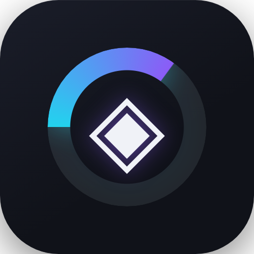
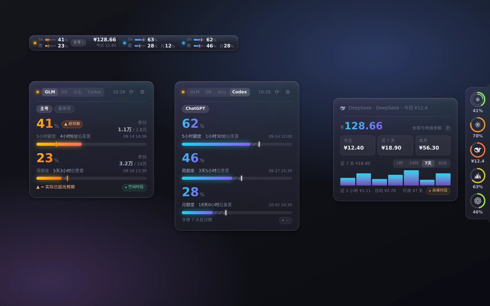

<div align="center">
  
  <h1>QuotaDock</h1>
  <p><strong>常驻桌面的 AI 额度与余额监控挂件</strong></p>
  <p>无需切换浏览器，在屏幕角落一眼掌握 GLM、DeepSeek、火山方舟、OpenAI Codex 与 Google Gemini 的实时配额与消费。</p>

  <p>
    <a href="https://github.com/liuxsh9/quotadock/actions/workflows/release.yml"></a>
    <a href="https://github.com/liuxsh9/quotadock/releases/latest"></a>
    <a href="https://github.com/liuxsh9/quotadock/releases"></a>
    
    <a href="LICENSE"></a>
  </p>

  <p><strong>简体中文</strong> · <a href="README.en.md">English</a></p>
</div>

<p align="center">
  
  <br>
  <sub>悬浮胶囊（多平台多账户） · 展开详情面板（配速预测 / 消费柱图） · 流体贴边圆圈与悬停飞出卡片</sub>
</p>

## 核心特性

- **双形态常驻桌面**：平时为紧凑悬浮胶囊；拖至屏幕左 / 右边缘松手，自动吸附为流体圆角贴边圆圈（支持双环显示 5h + 周额度），鼠标悬停即刻弹出该账户详情卡片。
- **实时配速与超支预警**：进度条内置「时间均摊预期」斜纹参考线——实际消耗超前时自动标红超支段并转琥珀警示，提前感知额度透支风险。
- **多平台、多账户统一管理**：同一平台可同时挂载多个账号，支持「切换」与「平铺」两种胶囊布局，每个账户独立配色、独立提醒与独立贴边口径。
- **跨机器 SSH 免密直连**：针对登录在远程 Linux / Mac 服务器上的 **OpenAI Codex** 与 **Google Gemini (Antigravity)**，通过 Windows 内置 OpenSSH 免密读取最新状态，告别定期手工拷贝凭据。
- **原生级细节打磨**：背景明暗自动切换深浅磨砂玻璃、余额默认打码防窥、多显示器热插拔自适应、带抖动与限流退避的静默轮询、托盘常驻与开机自启。
- **零遥测、本地直连**：所有凭据仅存于本机配置文件，明文永不出主进程；请求直连各家官方域名，不经过任何第三方中转服务。

## 支持的服务商

| 服务商 | 监控内容 | 接入方式 | 特性亮点 |
|---|---|---|---|
| **GLM Coding Plan** | 5h / 周配额百分比、积分、重置倒计时 | API Key（推荐）或登录 Cookie | 峰谷时段标识、5h + 周双环 |
| **DeepSeek API** | 账户余额、今日 / 近 7 天 / 本月消费、可用天数 | API Key（选配平台 `userToken` 精确账单） | 2 分钟高频余额采样、4 档消费柱图、半价空闲时段提示 |
| **火山方舟 Coding / Agent Plan** | 5h / 周 / 月三窗口调用次数配额 | IAM 只读子账号 AK / SK | 自动识别套餐类型，支持同账号双套餐分账户监控 |
| **OpenAI Codex** | 5h / 周 / 月套餐配额、按模型额外限额 | **SSH 远程** / 本机 `~/.codex/auth.json` / 手动粘贴 | 仅读 `access_token`，绝不触发 `refresh_token` 登出原设备 |
| **Google Gemini (Antigravity)** | 5h / 周配额（Gemini 组与 Claude/GPT 组） | 官方 `agy` CLI（本机 / **SSH 远程**） | 只读零额度消耗、免密永不过期、支持模型组切换 |

## 下载与安装

支持 **Windows 10 / 11 (x64)**，前往 [Releases](https://github.com/liuxsh9/quotadock/releases/latest) 下载：

| 安装包 | 说明 |
|---|---|
| `QuotaDock-x.y.z-win64.zip` | **推荐 · 绿色目录版**：解压后双击 `QuotaDock/QuotaDock.exe`，约 1 秒冷启动，支持开机自启 |
| `QuotaDock Setup x.y.z.exe` | **标准安装版**：向导式安装，自动创建桌面快捷方式，支持开机自启 |
| `QuotaDock x.y.z.exe` | **单文件便携版**：即拷即用，每次启动需自解压（冷启动较慢，不支持开机自启） |

> 从旧版 **GLM 用量挂件** 升级时，首次启动会自动从 `%APPDATA%\GLM 用量挂件\` 无损复制已有配置与历史记录，无需重新配置。

<details>
<summary>Windows 首次运行提示「已保护你的电脑（未知发布者）」？</summary>

开源工具未购买商业代码签名证书，浏览器下载的压缩包会附带「来自互联网」标记。解压前右键 `.zip` → **属性** → 勾选 **解除锁定（Unblock）** 后再解压，或在弹窗点 **更多信息 → 仍要运行** 即可。

</details>

## 快速上手

1. 启动 **QuotaDock**，点击胶囊展开面板并进入右上角 **⚙ 设置**。
2. 在对应服务商分段点击 **＋ 添加账户**，填入凭据并保存（剪贴板命中凭据时会提示一键填入）：

| 服务商 | 所需凭据 | 获取入口 |
|---|---|---|
| **GLM** | API Key（推荐，长期有效）或 `bigmodel_token_production` Cookie | [bigmodel.cn](https://www.bigmodel.cn/coding-plan/personal/overview) → 控制台 API Keys |
| **DeepSeek** | `sk-` API Key（选配：控制台 LocalStorage `userToken`） | [platform.deepseek.com](https://platform.deepseek.com) → API Keys |
| **火山方舟** | **只读 IAM 子账号** AK / SK（见下方安全说明） | [console.volcengine.com/iam/keymanage](https://console.volcengine.com/iam/keymanage) |
| **OpenAI Codex** | SSH 主机别名 / 读本机 / 粘贴 `~/.codex/auth.json` | 详见 [数据来源与接口说明](docs/internals.md) |
| **Google Gemini** | 本机 `agy` CLI 或免密 SSH 主机别名 | 详见 [数据来源与接口说明](docs/internals.md) |

<details>
<summary>安全提示：火山方舟 IAM 只读子账号配置 & 跨机器 SSH 免密配置</summary>

- **火山方舟切勿使用主账号 AK/SK**：请创建仅勾选「编程访问」的 IAM 子用户，仅挂载 `ArkReadOnlyAccess` 与 `BillingCenterReadOnlyAccess` 两条只读预设策略。
- **Codex / Gemini 跨机器 SSH 免密**：在 Windows 的 `%USERPROFILE%\.ssh\config` 配置 `Host` 与 `IdentityFile`，并在终端验证 `ssh -o BatchMode=yes <别名> "echo ok"` 返回 `ok` 后，在挂件中直接填写该别名即可。

</details>

## 隐私与安全

- **本地存储**：配置与历史样本仅保存在 `%APPDATA%\QuotaDock\`，无任何云端同步或遥测上报。
- **进程隔离**：Electron 启用 `contextIsolation` + `sandbox`，凭据明文严禁出主进程（界面仅回显尾号）。
- **最小权限与安全执行**：外部链接仅放行已注册服务商官方域名；SSH 调用采用参数白名单与 `execFile`（不经 shell），杜绝命令注入。

## 文档与开发

- [使用手册](docs/manual.md)：多账户布局、贴边圆圈与双环口径、快捷操作、峰谷时段与已知边界
- [数据来源与开发指南](docs/internals.md)：各平台接口解析口径、目录架构、扩展新 Provider 与打包说明

```bash
git clone https://github.com/liuxsh9/quotadock.git
cd quotadock
npm install
npm start            # 本地启动（开发环境支持 F12 打开 DevTools）
npm run test:main    # 主进程集成测试（其余测试见 package.json）
```

## License

[MIT](LICENSE) © liuxsh9
